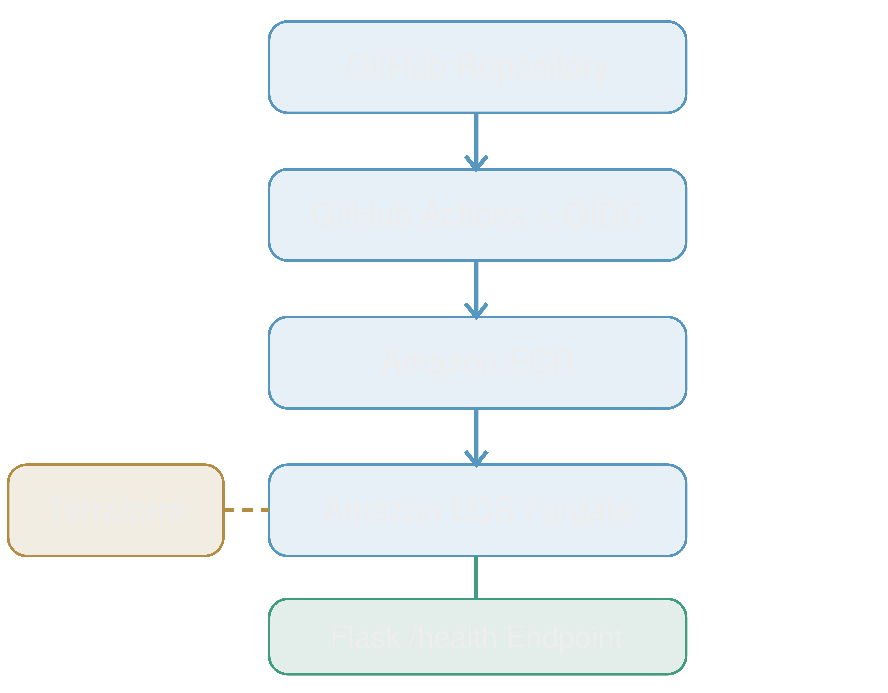

# CloudDeploy Pipeline — Automated Docker CI/CD Deployment to AWS ECS

## Project Overview

CloudDeploy Pipeline is a hands-on DevOps portfolio project demonstrating containerization, continuous integration, continuous deployment, and infrastructure management using AWS and Terraform.

The project automates the process of building a Python Flask application into a Docker image, pushing the image to Amazon Elastic Container Registry (ECR), and deploying it to Amazon Elastic Container Service (ECS) using AWS Fargate.

## Technology Stack

- **Python / Flask:** Web application with a health-check endpoint
- **Docker:** Application containerization
- **GitHub Actions:** Automated CI/CD workflow
- **AWS IAM / OIDC:** Secure GitHub Actions authentication without long-lived AWS access keys
- **Amazon ECR:** Docker image registry
- **Amazon ECS / Fargate:** Serverless container hosting
- **Terraform:** Infrastructure as Code for managing the existing ECS cluster and service

## CI/CD Workflow

1. Developer pushes application code to GitHub.
2. GitHub Actions executes the deployment workflow.
3. GitHub Actions authenticates to AWS using OIDC.
4. Docker builds the application image.
5. The image is pushed to Amazon ECR.
6. GitHub Actions registers an updated ECS task definition and deploys it to the ECS service.
7. ECS Fargate runs the updated application container.

## Infrastructure Management

Terraform tracks and manages the existing ECS cluster and ECS service. The infrastructure was imported into Terraform state, validated, and checked for configuration drift.

GitHub Actions manages application deployments, while Terraform manages the ECS infrastructure configuration.

## Application Health Check

The Flask application exposes a `/health` endpoint that returns a JSON health status. This endpoint was tested against the running ECS Fargate application.

## Architecture Diagram

### Flask Application Functionality & Health Verification

The Python Flask application was developed as a lightweight HTTP workload to demonstrate automated container deployment and application health verification on AWS ECS Fargate.

The application exposes a `/health` endpoint that returns a JSON response indicating its health status.

**Engineering Purpose:**

- Validate that the Flask application starts and responds to HTTP requests after deployment.
- Provide a test workload for the Docker, Amazon ECR, and ECS Fargate deployment pipeline.
- Demonstrate application-level health verification through a dedicated HTTP endpoint.
- Establish a foundation for future automated health checks and monitoring.

**Validation:**

After deployment, the `/health` endpoint was manually tested to confirm the application was accessible and responding successfully.

This project focused on demonstrating cloud infrastructure, container orchestration, and CI/CD automation rather than implementing complex business functionality.

## Troubleshooting & Lessons Learned

### ECS Fargate — CannotPullContainerError

**Problem**

During deployment of the containerized Flask application, an ECS Fargate task encountered a `CannotPullContainerError`, preventing the container from starting.

**Root Cause**

The ECS task execution role lacked the necessary IAM permissions to pull the Docker image from Amazon Elastic Container Registry (ECR).

**Resolution**

Attached the AWS-managed `AmazonECSTaskExecutionRolePolicy` to the ECS task execution role, granting the permissions required to authenticate with ECR and retrieve the container image.

**Lessons Learned**

- **IAM troubleshooting:** Learned how missing permissions can prevent ECS tasks from starting.
- **Task role vs. execution role:** Understood that the task execution role allows ECS to perform operations such as pulling images and sending logs to CloudWatch, while the task role grants permissions to application code running inside the container.
- **ECR integration:** Strengthened understanding of how ECS Fargate authenticates with Amazon ECR.
- **Deployment reliability:** Recognized the importance of validating IAM permissions when troubleshooting container startup failures.
